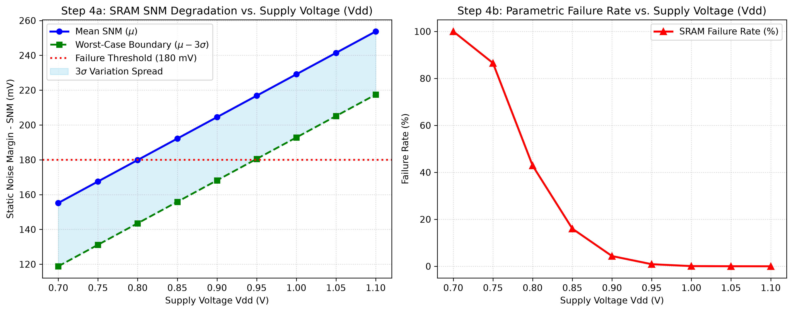

# Monte Carlo Analysis of 6T SRAM Reliability under Process Variations


## Overview

As CMOS technology scales down into the nanometer regime, manufacturing process variations—primarily **Random Dopant Fluctuations (RDF)** and line-edge roughness—induce significant threshold voltage ($V_{th}$) mismatch across adjacent transistors. In **6-Transistor Static Random-Access Memory (6T SRAM)** cells, these variations degrade cell stability and can cause catastrophic read or hold failures.

This project implements a fully vectorized **Monte Carlo simulation framework** from scratch using Python (`NumPy` and `Matplotlib`) to evaluate the statistical reliability, Static Noise Margin (SNM), and parametric yield of a 6T SRAM cell across 10,000 randomized die samples and varying supply voltages ($V_{DD}$).

## Key Highlights

* **Zero-Loop Pure NumPy Vectorization:** Utilizes 2D `(10000, 250)` and 3D `(9, 10000, 200)` NumPy array broadcasting to simultaneously evaluate up to 90,000 SRAM states without Python `for` loops.
* **Statistical Transistor Variation Modeling:** Generates Gaussian-distributed threshold voltage ($V_{th}$) variations ($\mu = 0.40\text{ V}$) for NMOS and PMOS devices to emulate nanoscale CMOS fabrication tolerances.
* **6T SRAM Butterfly Curve & Automated SNM Extraction:** Models the cross-coupled inverter pair's Voltage Transfer Characteristics (VTC) and numerically extracts the **Static Noise Margin (SNM)** via $45^\circ$ diagonal projection.
* **Large-Scale Monte Carlo Yield & $V_{DD}$ Scaling Analysis:** Quantifies tail-distribution failures across 10,000 SRAM cells and demonstrates the non-linear surge in parametric failure rate as $V_{DD}$ scales down from $1.10\text{ V}$ to $0.70\text{ V}$.

## Project Structure

```text
sram-reliability-monte-carlo/
├── sram-reliability-monte-carlo.ipynb  # Main Jupyter Notebook (Steps 1 to 4)
├── figures/                            # Generated high-resolution analysis plots
│   ├── step1_vth_hist.png              # Step 1: Transistor Vth Gaussian distribution
│   ├── step2_butterfly.png             # Step 2: Ideal vs. Mismatched Butterfly Curves
│   ├── step3_mc_snm_dist.png           # Step 3: 10,000-cell Monte Carlo SNM histogram
│   └── step4_vdd_scaling.png           # Step 4: SNM & Failure Rate vs. Vdd scaling
├── .gitignore                          # Git ignore configuration
└── README.md                           # Project documentation
```

## Simulation Results & Visual Analysis

### Step 1: Transistor Threshold Voltage ($V_{th}$) Variation
Models random manufacturing fluctuations across $10,000$ transistors using a Gaussian distribution $V_{th} \sim \mathcal{N}(0.40\text{ V}, 0.03\text{ V}^2)$.


### Step 2: 6T SRAM Butterfly Curve & Static Noise Margin (SNM)
Compares a balanced, nominal 6T SRAM bitcell ($\text{SNM} = 245.6\text{ mV}$) against a process-skewed cell suffering from severe $V_{th}$ mismatch, where the asymmetric eye shrinkage degrades stability to $\text{SNM} = 165.5\text{ mV}$.


### Step 3: Vectorized Monte Carlo SNM Distribution (10,000 Cells)
Evaluates $10,000$ independent 6T SRAM cells with uncorrelated 4-transistor $V_{th}$ variations ($\sigma_{V_{th}} = 40\text{ mV}$) at $V_{DD} = 1.0\text{ V}$. Because cell stability is governed by the weaker of the two butterfly lobes ($\text{SNM} = \min(\text{SNM}_{\text{top}}, \text{SNM}_{\text{bot}})$), the resulting distribution exhibits a left-skewed tail with a mean of $229.1\text{ mV}$ ($\sigma = 12.1\text{ mV}$) and $8$ tail failures below the $180\text{ mV}$ threshold ($0.08\%$ failure rate).


### Step 4: Supply Voltage ($V_{DD}$) Scaling & Parametric Yield Analysis
Uses 3D NumPy broadcasting across $9$ supply voltage levels ($0.70\text{ V}$ to $1.10\text{ V}$) to evaluate total-chip reliability under low-power voltage scaling. While the cell maintains near-zero failure rates at $V_{DD} \ge 1.0\text{ V}$, aggressive voltage scaling below $0.90\text{ V}$ pushes the $\mu - 3\sigma$ worst-case boundary below $180\text{ mV}$, causing parametric failure rates to spike exponentially.



## Getting Started

1. Clone this repository and install the required dependencies:
```bash
pip install numpy matplotlib jupyter
```
2. Open `sram-reliability-monte-carlo.ipynb` in PyCharm or Jupyter Notebook and run all cells sequentially to reproduce the statistical metrics and figures.