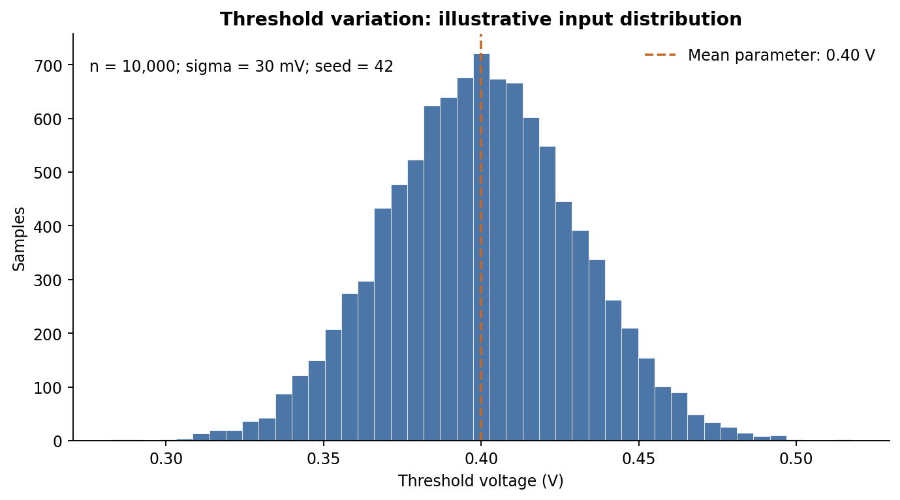
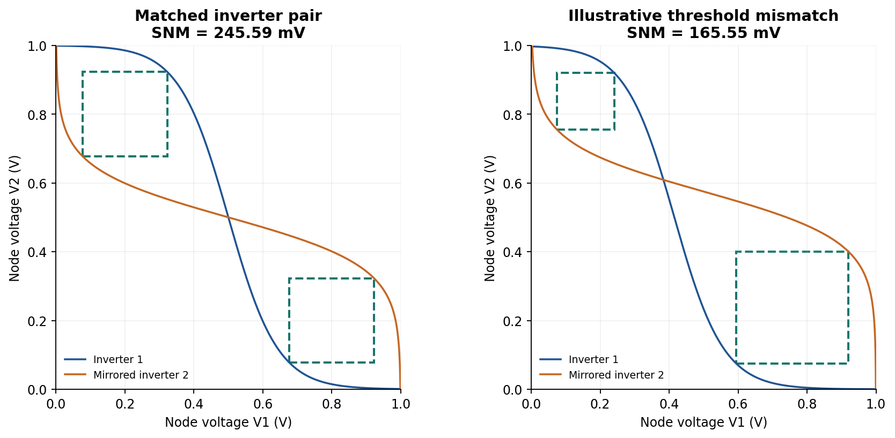
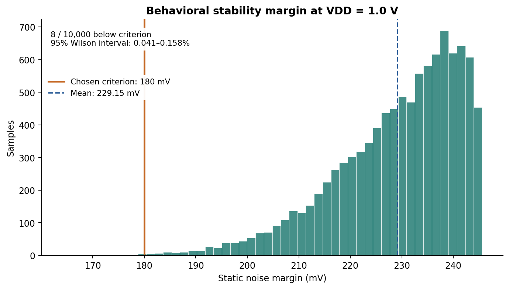

# Behavioral SRAM Stability Under Threshold Variation

**A Monte Carlo study of cross-coupled inverter stability, numerical extraction, and supply-voltage sensitivity.**

This project asks how independent threshold-voltage mismatch changes the static noise margin (SNM) of a simplified SRAM-inspired inverter pair. It combines a transparent behavioral model, 10,000 paired Monte Carlo samples, and an independent numerical reference.

**Scope:** the circuit is represented by two sigmoid voltage-transfer curves. There are no access transistors, bitlines, wordline, transistor current equations, or foundry models. The results describe the assumed model's static stability; they do not establish SRAM read/write yield or measured silicon reliability.

[Notebook](sram-reliability-monte-carlo.ipynb) · [Model and assumptions](docs/model.md) · [Numerical validation](docs/validation.md) · [Results data](data/) · [Engineering portfolio](https://github.com/c18663979619-cpu/engineering-research-portfolio)

## Main result

At **VDD = 1.0 V**, with independent Gaussian threshold offsets of **σ = 40 mV**, the revised calculation gives:

| Metric | Result |
|---|---:|
| Samples / random seed | 10,000 / 42 |
| Mean SNM | 229.15 mV |
| Standard deviation of SNM | 12.10 mV |
| Empirical 1st percentile | 193.28 mV |
| Samples below the chosen 180 mV criterion | 8 / 10,000 (0.08%) |
| 95% Wilson interval for that fraction | 0.041–0.158% |

The 180 mV criterion is an illustrative analysis choice, not a process specification. The interval quantifies finite-sample uncertainty within the assumed model, not uncertainty about its physical accuracy. [Criterion sensitivity data](data/criterion_sensitivity.csv) show how the count changes when this choice changes.


*The same threshold samples are reused at nine supply voltages. A fixed physical gain parameter of 14 V⁻¹ is used throughout. The dashed margin curve is an empirical 1st percentile; error bars are pointwise 95% Wilson intervals. Lines connect sampled voltages and do not establish an exponential law.*

## Engineering work demonstrated

- Translate threshold mismatch into explicit inverter switching-point shifts.
- Extract SNM from the two closed lobes of a butterfly curve.
- Use NumPy broadcasting in bounded batches to evaluate a Monte Carlo population.
- Compare the fast interpolated calculation with an independent bisection reference.
- Report sensitivity, uncertainty, model limitations, and a reproducible result trail.

The repository began as a four-stage Python notebook. The review revision separates the model from plotting, preserves the original sample sequence, and records changes in [validation notes](docs/validation.md). The behavioral assumptions and numerical workflow are the subject of this study; no new transistor model or experimental validation is claimed.

## Method and evidence

### 1. Make the variation assumptions explicit

The main experiment draws four independent threshold values per sample, each with mean 0.40 V and standard deviation 0.04 V. The input illustration below uses σ = 0.03 V to retain the original introductory example; it is separate from the main experiment. Both values are illustrative and are not calibrated to a process node or a Pelgrom area law.



### 2. Inspect the geometry before scaling the calculation



*At 1.0 V, the reference calculation gives 245.59 mV for the matched pair and 165.55 mV for the deliberately mismatched example. Dashed squares show each lobe's margin; the smaller one determines the sample's SNM.*

### 3. Examine the population and its tail



*The weaker-lobe operation produces an asymmetric distribution. A mean minus three standard deviations is therefore not presented as a guaranteed worst case. Zero observed events at higher supplies also does not imply zero probability.*

## Reproduce

Use **Python 3.12** from the repository root. The recorded run used Python 3.12.6, NumPy 2.3.5, and Matplotlib 3.10.7.

```bash
python3 -m venv .venv
source .venv/bin/activate
# Windows PowerShell: .venv\Scripts\Activate.ps1
python -m pip install -r requirements.txt
python run_analysis.py
python -m unittest discover -s tests -v
python validate.py
```

The script creates output directories automatically. `config.json` controls the seed, sample count, threshold distribution, gain, supply voltages, criterion, and numerical grids. To keep a separate experiment:

```bash
python run_analysis.py --config config.json --output experiment-output
```

For an executed notebook, install `requirements-notebook.txt` and run `python scripts/execute_notebook.py`. An interactive notebook editor is optional and installed separately. The notebook uses the same model and plotting code as the command-line workflow.

| Path | Purpose |
|---|---|
| `sram_model.py` | Behavioral VTC, batched SNM, independent reference, statistics |
| `run_analysis.py`, `config.json` | Reproducible analysis and experiment parameters |
| `tests/`, `validate.py` | Unit checks and quantified numerical comparison |
| `data/samples_1v/` | All 10,000 input samples and 1.0 V margins in ten 1,000-row CSV tables; manifest lists sample IDs |
| `data/supply_sweep.csv` | Nine-voltage summaries and confidence intervals |
| `data/summary.json` | Results, dependency versions, and source hashes |
| `docs/validation.md` | Original-versus-revised comparison and test scope |

## Limitations and next research steps

- Gain, mismatch, independence, and the threshold criterion are assumed. Correlated variation, geometry, temperature, and device sizing are absent.
- Supply sensitivity depends strongly on the gain-scaling assumption. The original sweep used a fixed normalized curve, while the revised default keeps gain fixed in V⁻¹; [the comparison](data/baseline_comparison.csv) makes the consequence visible.
- Numerical agreement is checked on representative cases and grids. It is not a proof over all possible parameters or a transistor-level validation.
- A useful next study would compare these trends with a documented transistor-level hold/read SNM baseline, then explore correlation and gain sensitivity. That work is not included here.

## References

- E. Seevinck, F. J. List, and J. Lohstroh, “Static-noise margin analysis of MOS SRAM cells,” *IEEE JSSC*, 22(5), 748–754, 1987. [DOI](https://doi.org/10.1109/JSSC.1987.1052809). Background for SNM; the sigmoid model here is an illustrative assumption.
- NIST/SEMATECH, [Confidence intervals for a binomial proportion](https://www.itl.nist.gov/div898/handbook/prc/section2/prc241.htm). Basis for the Wilson interval.
